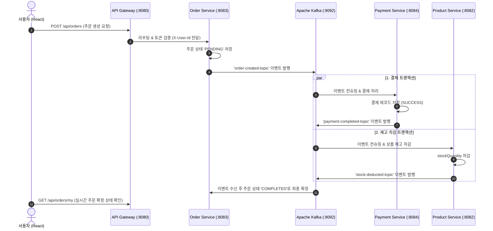

# 🛍️ NewShop: 대규모 트래픽 대비 Spring Boot & React 기반 MSA 쇼핑몰 플랫폼

실제 IT 기업의 협업 표준(GitHub Flow + Monorepo)과 마이크로서비스 아키텍처(MSA)를 완벽히 구현한 엔터프라이즈급 이커머스 솔루션입니다.

---

## 🏗️ 1. 아키텍처 구성도

```text
                                  [ React + TypeScript SPA ] (Vite)
                                                │
                                         [ API Gateway ] (:8080)
                                                │ (JWT Auth & Routing)
         ┌───────────────────────┬──────────────┴──────────────┬───────────────────────┐
         ▼                       ▼                             ▼                       ▼
   [ User Service ]      [ Product Service ]           [ Order Service ]       [ Payment Service ]
       (:8081)                 (:8082)                       (:8083)                 (:8084)
         │                       │                             │                       │
     MySQL (user_db)       MySQL (product_db)            MySQL (order_db)      MySQL (payment_db)
         │                       │                             │                       │
     Redis (Token)         Redis (Cache)                       └───────────┬───────────┘
                                 │                                         │
                                 └───────────── [ Apache Kafka ] ──────────┘
                                                 (Event-Driven SAGA)
```

### 핵심 기술 스택
- **프론트엔드**: React 18, TypeScript, Vite, Tailwind CSS, Axios, Lucide React
- **백엔드**: Java 21, Spring Boot 3.3.4, Spring Cloud Gateway, Spring Data JPA
- **데이터베이스 & 캐시**: MySQL 8.0 (Database per Service), Redis 7.0 (인증 토큰 & 상품 조회 캐싱)
- **메시지 브로커**: Apache Kafka (비동기 이벤트 기반 통신 & SAGA 패턴)
- **인프라 & CI/CD**: Docker (Multi-stage build), Docker Compose, Kubernetes (k8s), GitHub Actions

---

## 🚀 2. Kafka 이벤트 기반 SAGA 분산 트랜잭션 흐름



---

## 👥 3. IT 기업 실무 협업 표준 & Git 브랜치 전략

### 3.1 브랜치 전략: GitHub Flow
- **`main`**: 항상 배포 가능한 최신 프로덕션 브랜치 (Protected Branch 설정)
- **`feature/<기능명>`**: 서비스별/도메인별 기능 개발 브랜치 (예: `feature/order-saga`, `feature/user-auth`)
- **`fix/<버그명>`**: 일반 버그 수정 브랜치
- **`hotfix/<긴급패치>`**: 운영 장애 즉각 대응 브랜치

### 3.2 Monorepo CI/CD (Path-based Filtering)
하나의 저장소에서 프론트엔드와 여러 백엔드 마이크로서비스를 관리하되, GitHub Actions의 `paths` 필터를 적용하여 **수정된 서비스만 독립적으로 빌드·테스트·배포**합니다.
- `backend/**` 변경 시: Java 21 빌드, 단위 테스트 수행
- `frontend/**` 변경 시: TypeScript 컴파일 및 Vite 번들 빌드

### 3.3 실무 개발 7단계 사이클
1. **GitHub Issue 생성**: 작업 목적, 요구사항, 완료 조건(Acceptance Criteria) 명시
2. **기능 브랜치 생성**: `git switch -c feature/order-saga`
3. **코드 작성 및 단위/통합 테스트**: 클린 코드 및 비즈니스 로직 작성
4. **커밋 컨벤션 준수**:
   - `feat:` 새로운 기능 추가
   - `fix:` 버그 수정
   - `refactor:` 코드 리팩토링
   - `test:` 테스트 코드 작성
   - `chore:` 빌드 스크립트 및 설정 변경
5. **Pull Request (PR) 생성**: PR 템플릿에 따라 변경 내용 및 검증 결과 기술
6. **자동화 CI 파이프라인 검증**: GitHub Actions 자동 빌드/테스트 통과
7. **코드 리뷰 및 Squash & Merge**: 동료 리뷰(최소 1인 승인) 후 main 병합 및 브랜치 삭제

---

## 💻 4. 로컬 개발 환경 실행 방법

### 4.1 데이터베이스 & Kafka 인프라 실행 (Docker Compose)
MySQL(4개 독립 DB 스키마 생성), Redis, Kafka를 원클릭으로 구동합니다:
```bash
cd infra/docker
docker compose up -d
```
- **MySQL**: `localhost:3306` (계정: `shopuser` / 비번: `shoppassword`)
  - `user_db`, `product_db`, `order_db`, `payment_db`
- **Redis**: `localhost:6379`
- **Kafka**: `localhost:9092`

### 4.2 백엔드 마이크로서비스 실행 (Spring Boot)
```bash
cd backend
# 백엔드 전체 빌드
./gradlew build -x test

# 각 서비스 실행 (개별 터미널)
./gradlew :api-gateway:bootRun       # Port 8080
./gradlew :user-service:bootRun      # Port 8081
./gradlew :product-service:bootRun   # Port 8082
./gradlew :order-service:bootRun     # Port 8083
./gradlew :payment-service:bootRun   # Port 8084
```

### 4.3 프론트엔드 실행 (React + TypeScript)
```bash
cd frontend
npm install
npm run dev
```
브라우저에서 `http://localhost:5173` 접속 시 모던 쇼핑몰 화면을 바로 이용하실 수 있습니다.

---

## ☸️ 5. Kubernetes (k8s) 프로덕션 배포

`infra/k8s` 디렉터리에 정의된 매니페스트를 적용하여 쿠버네티스 클러스터에 배포할 수 있습니다:
```bash
kubectl apply -f infra/k8s/00-namespace.yaml
kubectl apply -f infra/k8s/01-configmaps-secrets.yaml
kubectl apply -f infra/k8s/
```
- 무중단 롤링 업데이트 (`Deployment` replicas 2개)
- Liveness / Readiness 프로브를 통한 장애 자동 복구
- Ingress를 통한 단일 진입점 외부 라우팅 (`/api` -> 게이트웨이, `/` -> 프론트엔드)

---

## 📁 6. 디렉터리 구조

```text
newShop/
├── .github/
│   ├── ISSUE_TEMPLATE/       # 기능 개발 및 버그 제보 템플릿
│   ├── PULL_REQUEST_TEMPLATE.md
│   └── workflows/            # 백엔드 및 프론트엔드 독립 CI 파이프라인
├── backend/
│   ├── build.gradle          # 루트 멀티 모듈 빌드 설정
│   ├── settings.gradle
│   ├── common/               # 공통 DTO, ErrorCode, JWT, Kafka Event
│   ├── api-gateway/          # Spring Cloud Gateway (라우팅 & 인증)
│   ├── user-service/         # 사용자 & 인증 서비스
│   ├── product-service/      # 상품 & 재고 서비스 (Redis 캐싱)
│   ├── order-service/        # 주문 관리 & Kafka Producer
│   └── payment-service/      # 결제 승인 & Kafka Consumer
├── frontend/                 # React 18 + TypeScript + Vite SPA
├── infra/
│   ├── docker/               # 로컬 Docker Compose 인프라
│   └── k8s/                  # 쿠버네티스 배포 매니페스트
├── task.md                   # 단계별 진행 태스크 목록
├── implementation_plan.md    # 상세 구현 설계 문서
└── README.md
```
