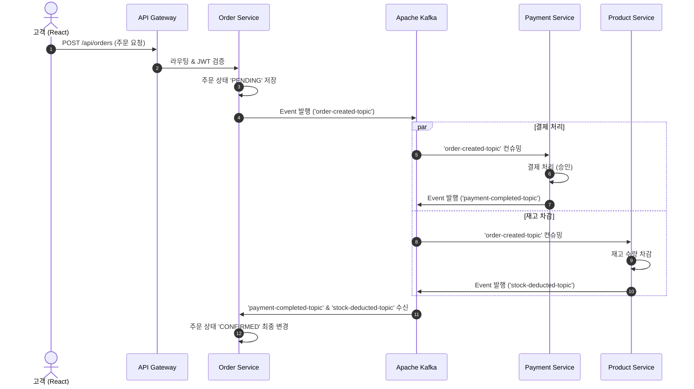

# MSA 쇼핑몰 구축 및 실무 협업 구현 계획서 (implementation_plan.md)

## 1. 개요 및 설계 목표
실제 IT 기업의 MSA 개발 및 깃허브 협업 표준(GitHub Flow + Monorepo)을 준수하여, 각 서비스가 독립적으로 빌드·테스트·배포될 수 있는 완전한 이커머스 MSA 플랫폼을 구축합니다.

### 핵심 기술 스택
- **프론트엔드**: React 18, TypeScript, Vite, Tailwind CSS, Axios, Lucide React
- **백엔드**: Java 17+, Spring Boot 3.x, Spring Cloud Gateway, Spring Data JPA
- **데이터 저장소 및 캐시**: MySQL 8.0 (서비스별 독립 DB), Redis 7.0 (세션/토큰/캐시)
- **메시지 브로커**: Apache Kafka (서비스 간 비동기 이벤트 기반 통신 & SAGA 패턴)
- **인프라 & CI/CD**: Docker (Multi-stage build), Docker Compose, Kubernetes (k8s), GitHub Actions

---

## 2. 모노레포(Monorepo) 아키텍처 및 디렉터리 구조

```text
newShop/
├── .github/
│   ├── ISSUE_TEMPLATE/
│   │   ├── feature_request.md
│   │   └── bug_report.md
│   ├── PULL_REQUEST_TEMPLATE.md
│   └── workflows/
│       ├── ci-gateway.yml
│       ├── ci-user.yml
│       ├── ci-product.yml
│       ├── ci-order.yml
│       ├── ci-payment.yml
│       └── ci-frontend.yml
├── backend/
│   ├── build.gradle (루트 멀티 프로젝트 설정)
│   ├── settings.gradle
│   ├── common/             # 공통 DTO, ErrorCode, Kafka Event 스키마, JWT 유틸
│   ├── api-gateway/        # 라우팅, JWT 인증 필터, Rate Limiting
│   ├── user-service/       # 회원가입, 로그인, 인증 토큰 발급 (MySQL: user_db, Redis)
│   ├── product-service/    # 상품 목록/상세, 재고 관리 (MySQL: product_db, Redis 캐싱)
│   ├── order-service/      # 주문 접수, 주문 상태 관리, 이벤트 발행 (MySQL: order_db)
│   └── payment-service/    # 결제 승인/취소, Kafka 이벤트 컨슈밍 (MySQL: payment_db)
├── frontend/               # React + TypeScript 쇼핑몰 SPA 클라이언트
├── infra/
│   ├── docker/
│   │   ├── docker-compose.yml       # 로컬 개발용 인프라 (MySQL 4개, Redis, Kafka)
│   │   └── mysql/init/              # 서비스별 초기 DB 스키마
│   └── k8s/                         # 쿠버네티스 배포 매니페스트 (Namespace, Deploy, Svc, Ingress)
├── task.md
├── implementation_plan.md
└── README.md
```

---

## 3. 실무 협업 기준 Git 브랜치 및 작업 프로세스

### 3.1 브랜치 전략: GitHub Flow
- `main`: 항상 프로덕션 배포 가능한 최신 상태 유지 (Protected Branch)
- `feature/<기능명>`: 신규 기능 개발 브랜치 (예: `feature/user-auth`, `feature/order-saga`)
- `fix/<버그명>`: 일반 버그 수정 브랜치
- `hotfix/<긴급패치>`: 운영 장애 긴급 대응 브랜치

### 3.2 작업 표준 사이클 (7단계)
1. **GitHub Issue 작성**: 작업 목적, 요구사항, 수락 조건(Acceptance Criteria) 기술
2. **브랜치 생성**: `git switch -c feature/order-saga`
3. **기능 구현 & 단위/통합 테스트**: TDD 또는 구현 후 검증 테스트 코드 작성
4. **커밋 컨벤션 준수**:
   - `feat:`, `fix:`, `refactor:`, `test:`, `docs:`, `chore:` 접두어 명시
5. **Pull Request (PR) 생성**: PR 템플릿 항목(작업 내용, 테스트 결과, 체크리스트) 작성
6. **GitHub Actions 자동 CI 통과**: Monorepo Path Filtering으로 수정된 서비스만 빌드/테스트 수행
7. **코드 리뷰 및 Squash & Merge**: 승인 후 `main` 브랜치에 병합 및 feature 브랜치 삭제

---

## 4. MSA 서비스 간 데이터 흐름 및 Kafka 이벤트 기반 SAGA 패턴



---

## 5. 단계별 구현 세부 계획

### Step 1: 협업 환경 & Git 저장소 기초 세팅
- Git 초기화 및 `.gitignore`, GitHub Issue/PR 템플릿 생성
- README.md에 아키텍처 및 협업 가이드 문서화

### Step 2: 로컬 인프라 환경 구성 (Docker Compose)
- 독립된 MySQL 컨테이너 4개(user_db, product_db, order_db, payment_db) 또는 단일 인스턴스 내 멀티 데이터베이스 및 초기화 DDL
- Redis 컨테이너 (포트 6379)
- Apache Kafka & Zookeeper 컨테이너 (포트 9092)

### Step 3: 백엔드 모듈 구축 (Spring Boot 멀티 모듈)
- 루트 Gradle 멀티모듈 빌드 설정
- `common`: 공통 Response, 예외 핸들러, BaseEntity, JWT Provider, Kafka Event 모델
- `api-gateway`: Spring Cloud Gateway 라우팅 설정, Global Auth Filter, CORS
- `user-service`: 회원가입, 로그인(BCrypt + JWT), Refresh Token(Redis), 마이페이지
- `product-service`: 상품 CRUD, Redis 캐시(조회 성능 향상), 상품 재고 제어
- `order-service`: 주문 생성, Kafka Producer/Consumer, 주문 내역 조회
- `payment-service`: 결제 내역 저장, Kafka Consumer(주문 이벤트) -> 결제 완료 Producer

### Step 4: 프론트엔드 (React + TypeScript)
- Vite + React + TypeScript 환경 셋업
- Tailwind CSS 기반 모던 UI 컴포넌트 (네비게이션, 모달, 토스트, 상품 카드 등)
- 페이지 구현:
  - 홈 / 상품 목록 & 필터링
  - 상품 상세 및 장바구니 담기
  - 장바구니 & 주문서 작성
  - 주문 완료 / 마이페이지 주문 내역
  - 로그인 / 회원가입
- Axios API 클라이언트: 토큰 자동 주입 및 에러 인터셉터

### Step 5: CI/CD 및 Kubernetes 매니페스트
- 서비스별 Dockerfile 작성 (경량 Alpine/Distroless 기반 Multi-stage build)
- GitHub Actions 워크플로우: Monorepo `paths` 필터를 이용한 서비스별 독립 CI 파이프라인
- Kubernetes YAML:
  - `namespace.yaml`
  - `configmaps.yaml`, `secrets.yaml`
  - 각 서비스별 `deployment.yaml` 및 `service.yaml`
  - `ingress.yaml`

---

## 6. 검증 계획
1. **단위 및 통합 테스트**: 각 서비스별 JUnit 5 테스트 수행
2. **Docker Compose 로컬 기동 검증**: DB, Redis, Kafka 정상 구동 확인
3. **E2E 시나리오 테스트**:
   - 회원가입 -> 로그인 -> 토큰 획득
   - 상품 등록 및 조회 (Redis 캐시 검증)
   - 장바구니 담기 -> 주문 생성
   - Kafka 이벤트 전파 (결제 처리 -> 재고 차감 -> 주문 확정) 확인
4. **프론트엔드 연동 테스트**: 브라우저 화면을 통한 전체 쇼핑몰 시나리오 검증
